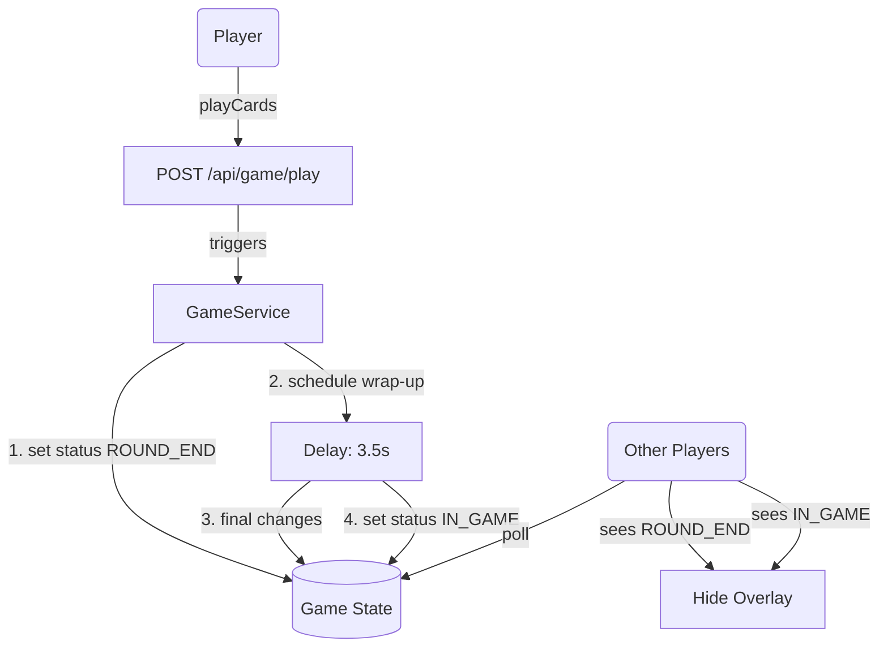

# Requirements

### Overview & Goals
Provide visual feedback and a mandatory pause at the end of each round in the ILJIG game. This allows players to see what happened (which cards were beaten or taken) and gives them a moment to memorize the cards before they leave the game or enter a player's hand.

### User Stories
- **As a player**, I want to see the beating cards for a few seconds before they are removed, so that I can keep track of which cards have been played.
- **As a player**, I want a clear message when someone takes the cards from the table, so I understand why the round ended and where the cards went.

### Functional Requirements
- When a round ends because all cards were beaten, the game enters a `ROUND_END` state for 3 seconds. The table remains unchanged during this time.
- When a player chooses to "Take" cards, the game enters a `ROUND_END` state for 3 seconds. The cards remain on the table and a message "Player [Name] took cards" is displayed.
- After the delay, the round state is finalized (cards cleared or moved to hand, hands refilled, next leader set) and the status returns to `IN_GAME`.
- The transition must be visible to all players simultaneously.


# Technical Design

### Current Implementation
Rounds end immediately when a player "Takes" or when the next turn would return to the leader after everyone else beat/passed. The cards are cleared/moved, turn shifts, and hand refilling happens atomically within the `playCards` API call.

### Proposed Changes
- **API Extension**: Introduce `ROUND_END` status and a `lastRoundResult` object containing metadata about the round outcome.
- **Backend Delay**: Use a background task to handle the transition.
  - The `playCards` call will trigger the start of the `ROUND_END` phase and return success.
  - The backend will hold the status in `ROUND_END` for 3.5 seconds.
  - The backend will perform the cleanup (refill hands, move/clear cards) **after** the delay.
- **Frontend Synchronization**: Shorten polling interval to ensure snappy feedback.
- **Visuals**: A non-intrusive overlay or status bar message during `ROUND_END`.

### Data Models / Contracts
**RoundResult (in `openapi.yml`)**:
```yaml
RoundResult:
  type: object
  properties:
    type:
      type: string
      enum: [BEAT, TAKE]
    playerId:
      type: string
    playerName:
      type: string
```

### Architecture Diagram


### Risks
- **Concurrency**: Need to ensure players can't make additional moves while the status is `ROUND_END`. The `playCards` validation should check for `IN_GAME` status only.
- **Polling Misses**: With 3s polling, a 3s delay might be missed or truncated. 1s polling is recommended.


# Testing

### Validation Approach
Verification will focus on the state transition timing and the visibility of the "intermediate" state.

### Key Scenarios
- **Taking Cards**: Verify that `cardsOnTable` remains populated for 3 seconds after clicking "Take".
- **Successful Beating**: Verify that cards stay on the table when the round ends by beating all cards.
- **Status Recovery**: Verify the game returns to `IN_GAME` and the next leader can move after the pause.
- **Messages**: Check that the correct player name is shown in the taking message.


# Delivery Steps

### ✓ Step 1: Extend API Specification for Round Transitions
Extend the `openapi.yml` specification to support the new `ROUND_END` state and round result information.

- Add `ROUND_END` to the `status` enum in `GameStatus`.
- Add a new `RoundResult` schema with `type` (TAKE/BEAT), `playerId`, and `playerName`.
- Add the `lastRoundResult` field to the `GameStatus` schema.
- Run `npm run api:generate` to update the TypeScript client.

### ✓ Step 2: Implement Delayed Round End Logic in Backend
Update the `GameService` logic to introduce the 3-second pause and the `ROUND_END` status.

- Modify `handleTake` to transition to `ROUND_END` and delay the transfer of cards and turn change.
- Modify `updateTurn` to detect the end of a round after beating and transition to `ROUND_END` with a delayed table clear and leader update.
- Implement a thread-based delay (or `ScheduledExecutorService`) to transition back to `IN_GAME` after 3.5 seconds.
- Ensure all intermediate state (like played cards) is preserved in `GameStatus` during the pause.

### ✓ Step 3: Enhance UI for Round Transition pause and Messages
Update the frontend components to visualize the round transition and the pause.

- Modify `GameStore` to poll every 1 second during the game to ensure the `ROUND_END` state is captured reliably.
- Update `GameComponent.html` to display a 3-second overlay during `ROUND_END` status.
- Implement dynamic messaging in the overlay: "Player [Name] took cards" or "Cards beaten".
- Add necessary CSS styles for the overlay and table highlighting to `game.component.css`.
- Ensure the table remains visible during the pause.